# 🏏 WSCC — Weekend Cricket League Platform

A full-stack, installable (PWA) platform for running a weekend cricket league: **allow-listed login**, **timed availability polls** with millisecond-precision first-come ranking, **per-day & per-slot backouts**, an **AI/statistical round-robin scheduler**, tournaments, grounds, stats, and a 1-click team directory — all served from **one port / one domain** and **Vercel-deployable**.

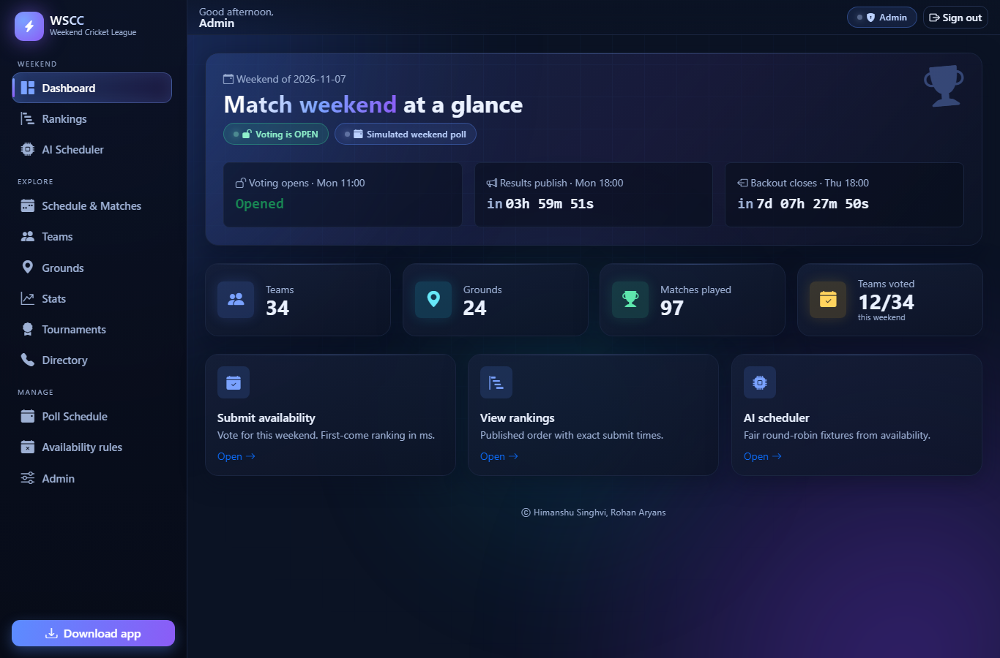

> **Stack:** React 18 + Bootstrap 5 + Framer Motion (PWA) · FastAPI (Python 3.12) · Supabase (Postgres + Auth + Row-Level Security) · Azure OpenAI (GPT) · single-origin (`/api`) · Vercel-ready.

---

## Table of contents
1. [Quick start](#-quick-start-one-port)
2. [Personas & capabilities](#-personas--capabilities)
3. [Feature guide (with screenshots)](#-feature-guide)
4. [Testing: accounts & one-click simulation](#-testing-accounts--one-click-simulation)
5. [How to use — role walkthroughs](#-how-to-use--role-walkthroughs)
6. [Architecture & security](#-architecture--security)
7. [Deployment](#-deployment)
8. [Project structure](#-project-structure)

---

## 🚀 Quick start (one port)

**Prereqs:** Node 20+, Python 3.12+. (Supabase + Azure OpenAI are optional — without them the app runs in an offline **demo/dev mode** with mock data and test logins.)

```bash
# 1) configure (optional — skip to run in demo mode)
cp .env.example .env

# 2) build the frontend
cd frontend && npm install && npm run build

# 3) run the backend — it serves the API AND the built UI on ONE port
cd ../backend && pip install -r requirements.txt
PYTHONPATH=. uvicorn app.main:app --host 0.0.0.0 --port 8077
```

Open **http://localhost:8077** — the UI is at `/`, the API at `/api/*`, health at `/api/health`, interactive API docs at `/docs`.

> **Hot-reload dev (optional, two ports):** `uvicorn app.main:app --reload --port 8077` + `cd frontend && npm run dev` (Vite on :5173 proxies `/api` → :8077).

PWA: open in a browser and use **“Install app” / “Download app”** — it installs and opens as a standalone window (still the same web app).

---

## 👤 Personas & capabilities

The app is **role-aware** — the sidebar and every route are gated by capabilities returned from `/api/meta/me`, and the backend independently enforces them.

| Capability | Admin | Team rep / player |
|---|:---:|:---:|
| View dashboard, schedule, teams, grounds, stats, tournaments, directory, rankings | ✅ | ✅ |
| Submit **availability** & **backout** | — | ✅ |
| **AI Scheduler** / schedule builder | ✅ | — |
| **Poll Schedule**, **Availability rules**, **Admin config** | ✅ | — |

| Admin sees | Team rep sees |
|---|---|
|  | 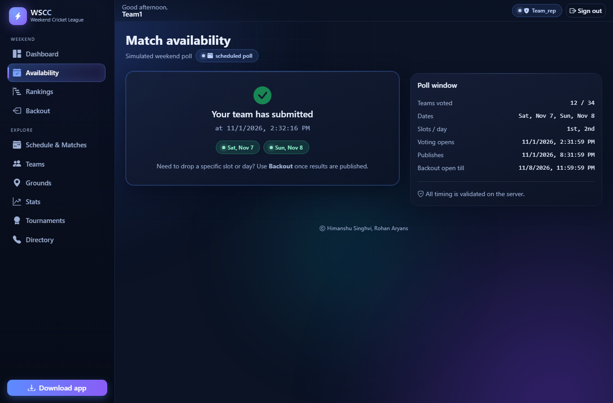 |

---

## ✨ Feature guide

### 1. Login — allow-listed emails, max 2 per team
Sign-in is restricted to an **allow-list** (Supabase magic-link in production; one-click **test accounts** in demo mode). Each team is capped at **2 active sessions**, enforced server-side.

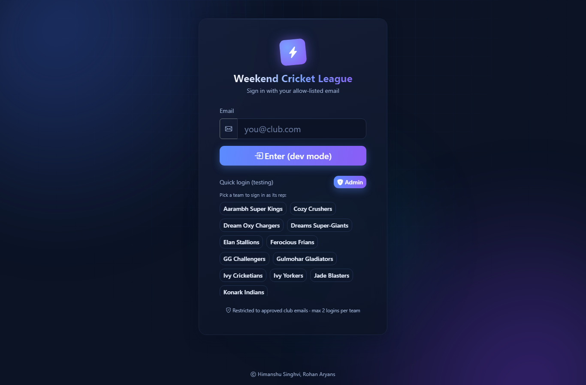

### 2. Availability poll (timed, first-come)
Teams opt in for the weekend's **dates**. Submissions are **time-stamped by the server to the millisecond** — the client clock is ignored. A team votes for the day(s) it can play (“All days” or individual days).


### 3. Rankings — transparent, first-come, to the millisecond
Published in submit order. Valid (on-time) votes are **🟢 green and ranked 1..N**; any vote cast **before the poll opened is 🔴 red** and excluded from the valid order. Each row shows the team's chosen dates and the exact submit time. Visible to everyone after publish; admins can preview earlier.

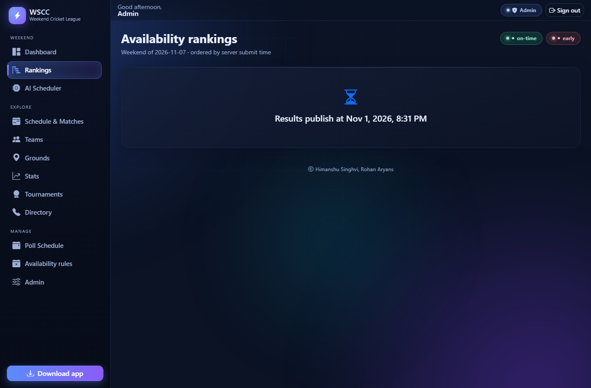

### 4. Backout — per day **and** per slot
Backout opens **as soon as a team has opted in** and stays open until the poll's **backout date/time**. A team can withdraw from **everything, a whole day, or a specific slot** (e.g. out for the 2nd slot on Saturday but still in for the 1st) — enforced on the server.

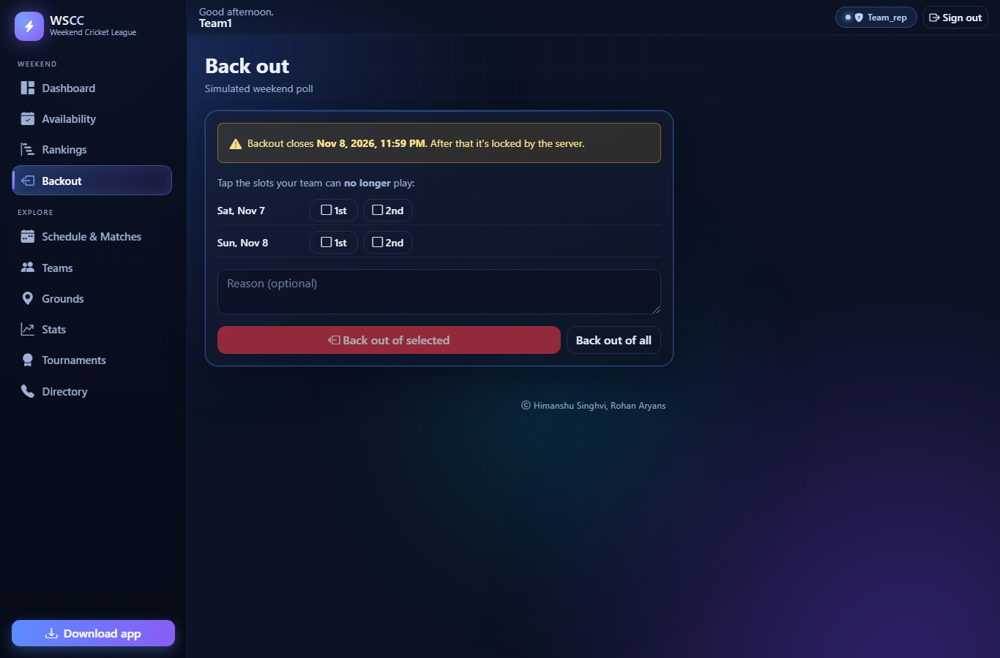

### 5. Schedule & Matches (past + upcoming)
Every fixture — **past results and upcoming matches** — with All / Upcoming / Past filters, a head-to-head table, and a **“My team only”** toggle for reps. Admins can schedule matches and record results inline.

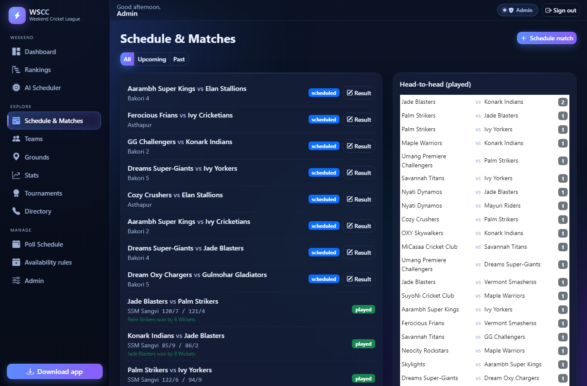

### 6. Teams & team detail
All league teams with recent form; tap a team for its **roster, win/loss record, head-to-head chart, and recent/upcoming matches**. Admins can add/edit teams.

| Teams | Team detail |
|---|---|
| 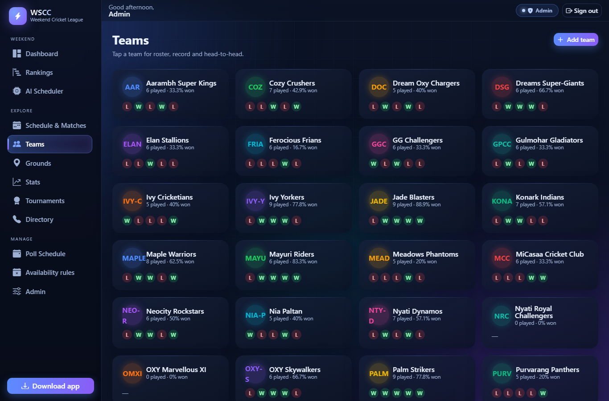 | 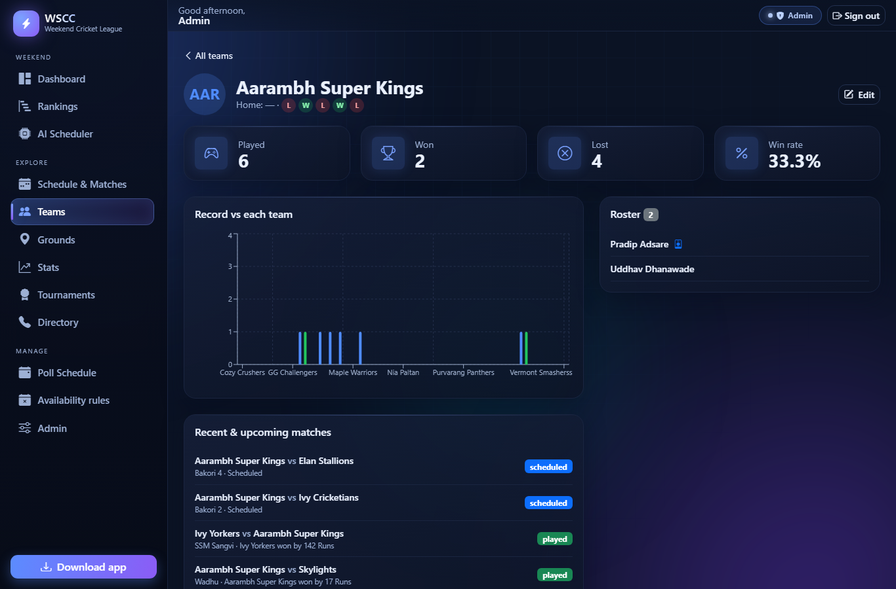 |

### 7. Grounds
The full venue list with pitch type, usage counts, pitch notes, and a 1-click **Open in Maps**. Admins can add/edit grounds.

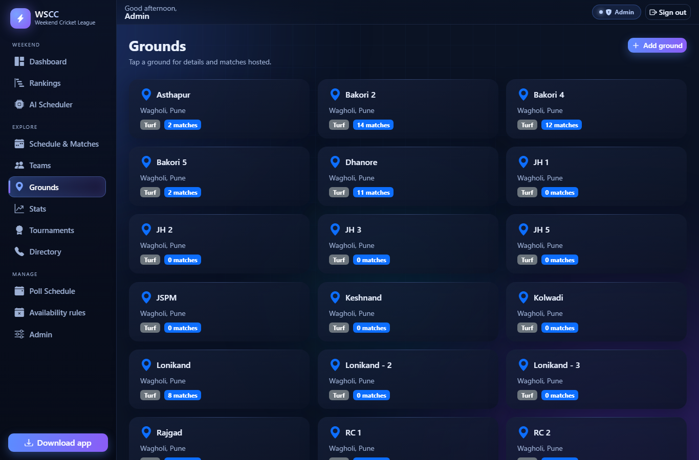

### 8. Stats
League **standings** (points, form), matches-by-month, ground usage, and a per-team head-to-head breakdown — all computed from real match data.

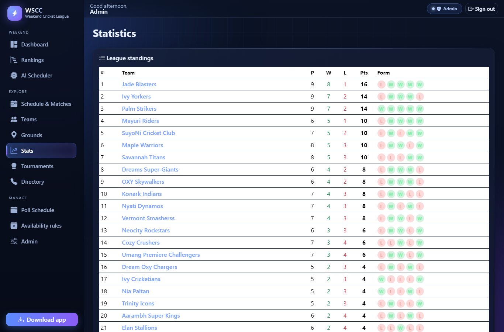

### 9. Tournaments
Per-tournament **details, polls (with live voting), participant availability, fixtures**, and **scoped per-tournament admins** who manage only their tournament.

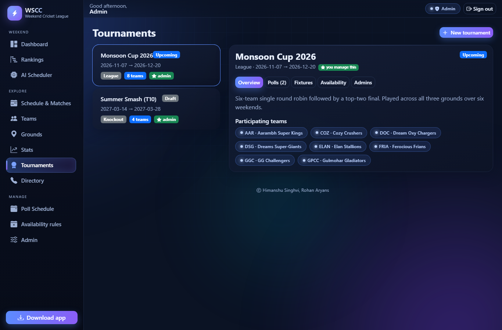

### 10. AI Scheduler / schedule builder (admin)
Generates a **fairness-first round robin** from the teams that responded to the poll: pairs who've met **least** are prioritised, **every match gets a different ground**, and a team never repeats an opponent or ground that weekend. You can pick the **date** (the poll's actual dates), tweak team selection & ground strategy, then **edit every fixture** (or build one from scratch) with live conflict detection, and **apply** it to create the matches. Azure OpenAI explains the fairness rationale.

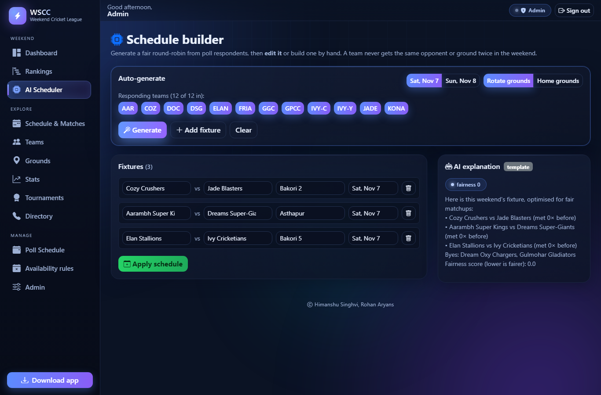

### 11. Directory (feature 9)
Every team rep with **1-click Call / WhatsApp** deep links, search, and a reps/everyone toggle.

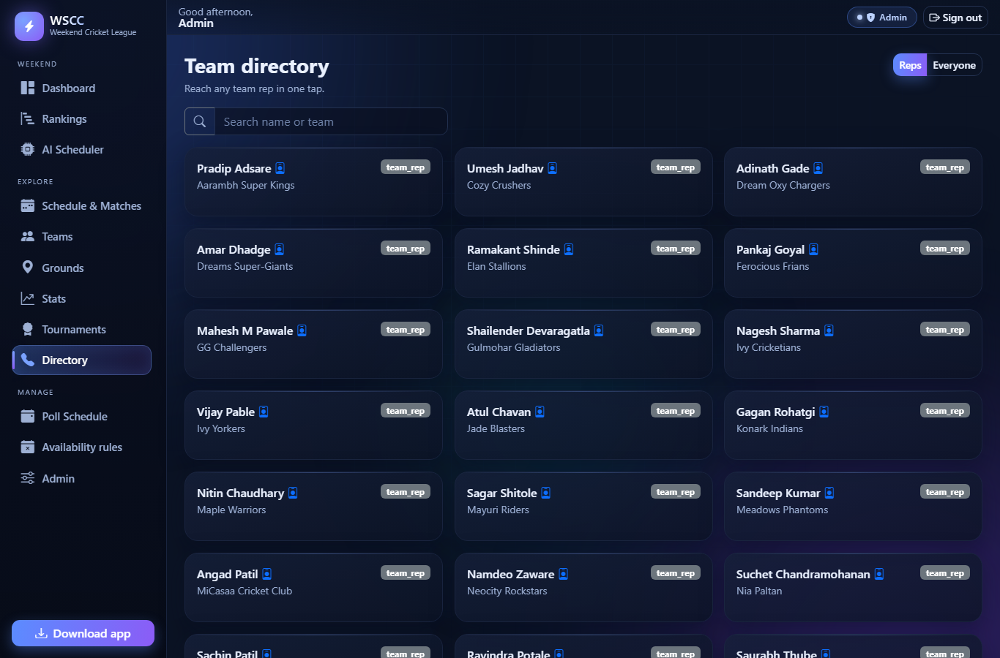

### 12. Poll Schedule (admin)
Schedule a one-off availability poll at an **exact date & time**, choose the **match dates** (multi-select calendar) and **slots per day**, and set when **backout** closes. A live/upcoming scheduled round overrides the weekly default; otherwise the recurring weekly cadence applies. Create / **edit** / delete.

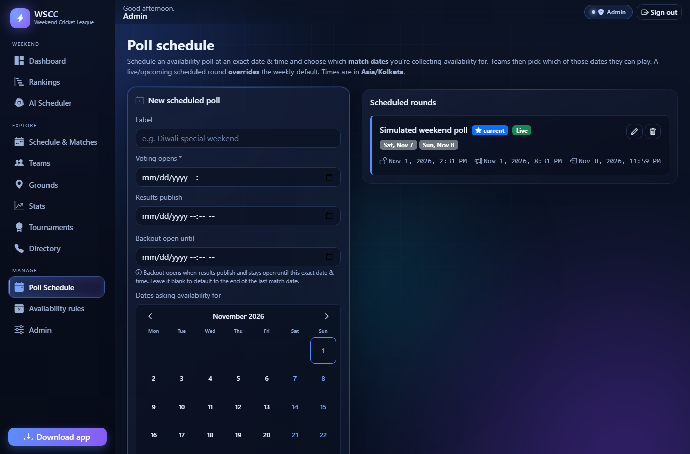

### 13. Availability rules (admin)
Temporarily **disable a ground / team / player** on specific weekdays (or “All days”) so they're excluded by the scheduler — with a **bulk “apply to all”** toolbar.

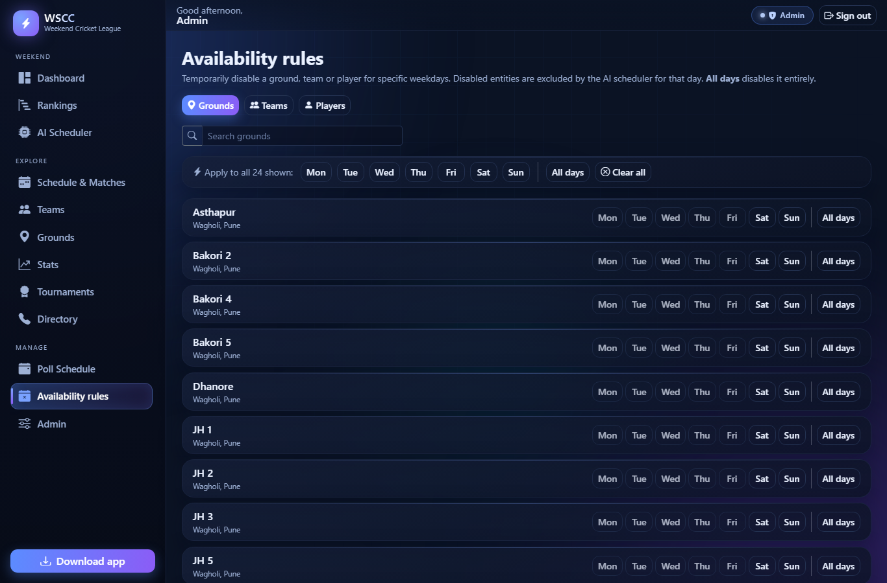

### 14. Admin settings + testing automation
Tune the voting cap (defaults to the whole league), session limits & policy, window times, timezone. In demo mode there's also a **one-click simulation** (see below).

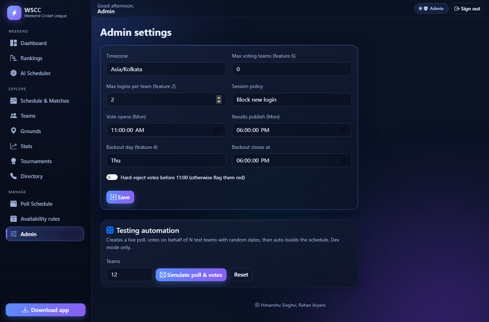

---

## 🧪 Testing: accounts & one-click simulation

In demo/dev mode the login page shows **quick-login buttons**: an **Admin** and one **per team**. Pick any to sign in as that persona.

From **Admin → Testing automation**, click **“Simulate poll & votes”** to, in one shot:
1. create a **live poll** (next Sat + Sun, 1st/2nd slots),
2. **vote on behalf of every test team** with random dates and staggered millisecond timestamps (plus a few “early” red votes),
3. **auto-build & apply the schedule** for each date.

Then explore **Rankings**, the **Schedule builder**, and **Schedule & Matches** to see populated data. A **Reset** button clears it.

---

## 🧭 How to use — role walkthroughs

**As an Admin**
1. **Poll Schedule → New** — set when voting opens, the match dates & slots, and when backout closes.
2. After teams vote, open **Rankings** to see the first-come order.
3. **AI Scheduler** — pick a date, Generate, edit if needed, **Apply** → fixtures become scheduled matches.
4. Record results in **Schedule & Matches**; standings/stats update automatically.
5. Use **Availability rules** to park a ground/team for a given weekday.

**As a Team rep**
1. **Availability** — during the open window, select the day(s) your team can play and submit.
2. **Rankings** — see where your team landed (and everyone's exact submit time) after publish.
3. **Backout** — if something changes, withdraw from a whole day or just a single slot before the backout deadline.
4. **Schedule & Matches → My team only** — track your past and upcoming games.

---

## 🏗️ Architecture & security

```
┌─────────────────────┐   same-origin /api    ┌──────────────────────┐
│  React + Bootstrap  │  ───────────────────▶ │   FastAPI backend    │
│  (PWA, Vite)        │  ◀─────────────────── │   (all validation)   │
└─────────────────────┘                        └──────────┬───────────┘
   served by FastAPI (one port) / Vercel static            │ service-role
                                                            ▼
                               ┌───────────────────────────┐   ┌────────────────┐
                               │  Supabase Postgres + RLS  │   │  Azure OpenAI  │
                               └───────────────────────────┘   └────────────────┘
```

**The client is untrusted.** Every rule that affects fairness, timing, or access is decided by the backend using the **server clock** and the authenticated identity, then backstopped by Postgres **Row-Level Security**:

- Email **allow-list** + **max 2 sessions/team**.
- Availability only within the window; `submitted_at` stamped server-side (ms); **first-come** order computed in SQL; early votes flagged.
- Backout only from opt-in until the backout deadline.
- Admin-only actions (scheduler, poll schedule, rules, config) enforced by capability checks **and** RLS.

Full details in **[SECURITY.md](SECURITY.md)**.

---

## ☁️ Deployment

One-domain deploy on **Vercel** (FastAPI as a Python serverless function under `/api`, the SPA as a static build, SPA fallback routing). Poll schedules and day-rules persist to **Supabase** when configured. Step-by-step + environment variables in **[DEPLOY.md](DEPLOY.md)**.

```bash
npm i -g vercel && vercel --prod
```

---

## 📁 Project structure

```
.
├── api/index.py            # Vercel serverless entry (exposes FastAPI app)
├── vercel.json             # /api → function, static SPA, SPA fallback
├── backend/app/
│   ├── main.py             # app factory: /api routers + serves frontend/dist
│   ├── core/               # config, supabase client, auth, time-windows, sample data
│   ├── services/           # poll scheduling, round-robin scheduler, analytics, AI
│   └── routers/            # one module per feature area (all under /api)
├── frontend/src/
│   ├── pages/              # one screen per feature
│   ├── components/         # Layout, SlotGrid, MultiDateCalendar, motion, Footer…
│   └── api/ · auth/        # same-origin fetch client + Supabase auth context
├── db/                     # schema.sql · rls_policies.sql · seed.sql
├── docs/screenshots/       # images used in this README
├── DEPLOY.md · SECURITY.md · PROGRESS.md
```

> Data note: the demo dataset is imported from the real WSCC CricClubs league (34 teams, 24 grounds, ~97 recent matches). See **PROGRESS.md** for the build history and what's real vs. seeded.

---

<p align="center"><sub>© Himanshu Singhvi, Rohan Aryans</sub></p>
